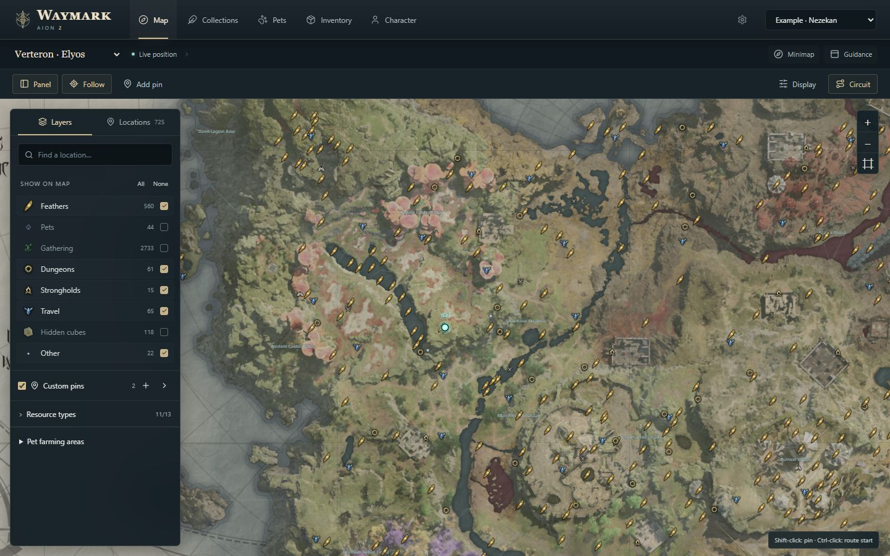
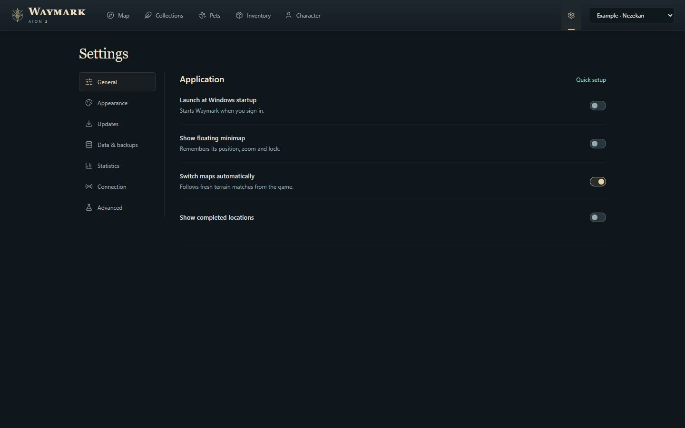

# Waymark: AION 2 Maps, Farming Routes & Pet Progress Tracker for Windows 11

    

---

Waymark is a Windows desktop application for AION 2 Global Steam that combines world maps, farming route planning, and pet collection tracking in a single native client. Terrain-aware map layers expose feathers, gathering nodes, kibelisks, sealed dungeons, and strongholds, with per-category and per-resource toggles plus persistent custom pins and saved circuits. A floating, click-through minimap stays above other windows and offers adjustable position and three zoom tiers so nearby objectives remain visible during play. Pet cards consolidate portraits, farming locations, levels, and soul progress, with closest-to-complete ordering and automatic rank verification via Windows OCR when the in-game pet screen is focused. All character observations, routes, pins, and settings are stored locally, and updates are verified against release signatures before installation.

## Features

- **Full world map coverage.** Locate feathers, gathering nodes, kibelisks, sealed dungeons and strongholds across Verteron, Altgard and the Abyss. Kibelisk names are provided in English for Verteron and Altgard, with dedicated Abyss reference maps included.

- **Layer and category filtering.** Toggle entire categories, resource groups or individual resources. Display all enabled markers when zoomed out, or enable grouping to reduce visual clutter on dense maps.

- **Custom routes and named pins.** Create named pins, designate a route start point and save a circuit for repeatable farming. Filters, follow mode, route selections and map views persist between sessions.

- **Floating minimap overlay.** Reposition the minimap window, cycle through three zoom tiers, or scroll to zoom while unlocked. The overlay stays above other windows and supports a locked, click-through mode.

- **Appearance customization.** Adjust the player marker and glow, pet rank colors and map accents from Settings → Appearance. Reset individual colors or restore the original palette.

- **Collection progress tracking.** Mark individual objectives complete or declare an entire category complete per character. Progress can be reset from Settings at any time.

- **Pet progression dashboard.** Pet cards consolidate portraits, names, farming locations, levels and soul progress. Sort by closest to completion (default), alphabetical, least progress first, or most recent pickups.

- **Live soul pickup detection.** Supported soul pickups update progress without requiring a relog. Reaching a tier threshold advances the displayed pet level automatically. Estimated starting levels are clearly labeled and refined as souls are observed.

- **Card verification via OCR.** If a level appears missing or stale, opening the corresponding in-game pet card with the game focused allows the app to verify the selected tile and update the saved rank and count. Uses Windows' built-in OCR and supports the English pet screen.

- **Server-shared pet progress.** Pet progress is shared across characters on the same server, with farming locations drawn from reference monster spawn points where available and labeled regional fallbacks elsewhere.

- **Persistent minimap state.** Minimap position, zoom tier and lock state are saved automatically. The title displays the detected region, retains a recent last-known region for up to 30 seconds, then reads as unavailable.

- **Recent souls strip.** A foldable strip on the minimap shows the latest three pets with portrait progress rings, rank colors and a brief completion effect before confirmed max-level pets leave the strip. Fold preference is saved.

- **Compact workspace layout.** Navigation is consolidated into a single compact header, freeing the map workspace for terrain. Floating Layers and Locations panels keep filters and search accessible while pet cards retain a consistent size with farming details opened separately.

- **Grouped settings.** Everyday preferences, appearance, updates, backups, statistics and connection tools are organized into clear sections with hover explanations for individual controls.

## How it works

Waymark combines an interactive world map, a persistent overlay, and a local observation pipeline into a single Windows desktop application. At startup, the app initializes a local profile store, loads saved filters, routes, and appearance preferences, and then establishes the map rendering surface. Map data and reference markers are shipped with the application, so exploration and route planning remain available without any additional configuration.

The floating minimap runs as a separate always-on-top window that renders the same map state as the main view at a reduced scale. It supports three discrete zoom tiers, free positioning, and a locked click-through mode; position, zoom level, and lock state are persisted between sessions so the overlay reappears exactly where it was left. When the minimap is unlocked, scroll-wheel input adjusts zoom in place. Region detection updates the minimap title, retains the last known region for a short grace period, and then falls back to an explicit unavailable state.

Marker rendering is driven by a layered filter model. Categories, resource groups, and individual resources can be toggled independently, and the renderer either draws every enabled marker when zoomed out or consolidates them into grouped clusters. Custom pins, route start points, and saved circuits are stored as named entries in the local profile and restored alongside map view state. Follow mode keeps the viewport centered on the tracked position while preserving the active filter set.

Position tracking derives from visible game terrain rather than memory access. Waymark identifies the active session, captures a visual fix when the in-game map is opened, and maintains a last-known marker when a fresh fix is unavailable. Character and pet reads use a passive network observation layer that requires a compatible capture driver; map planning, routing, and manual collection tracking function independently of it.

Pet progress is modeled per character and shared across characters on the same server. Each pet record holds a portrait reference, farming locations, an estimated or confirmed level, and a soul count. Missing starting levels are seeded as labeled estimates and advanced at defined soul thresholds; confirmed in-game readings replace estimates when available. Live soul pickups update the stored count without requiring a relog, and crossing a tier threshold advances the displayed level. Verification compares a selected in-game pet card against the stored record using built-in OCR and writes back the corrected rank and count.

Collection tracking operates at two granularities: individual objectives can be marked directly, or an entire category can be declared complete for a character. Progress counters, statistics, and completion states are written to the local store and can be reset from the settings area. A statistics view aggregates characters seen, connected time, observed souls, pets leveled, rank-ups, pets maxed, and launch counts, with options to copy a counts-only summary or export cumulative reporting data locally.

Updates are checked on launch and can be configured for automatic download and installation. The built-in updater verifies release signatures before applying an update and restarts the application on completion. All character observations, progress, pins, routes, layouts, and settings are persisted locally; the app does not request game credentials, control the character, or inject code into the game process.

## Requirements

**Operating system:** Windows 10 or Windows 11, 64-bit only. Older Windows versions and 32-bit installations are not supported.

**Runtime:** The app runs on the Microsoft Edge WebView2 runtime. If the runtime is missing, the installer includes a bootstrapper that installs it automatically. No separate runtime download is required.

**Display:** A minimum window size of 1280×720 is recommended for the full map workspace. The floating minimap can be positioned and scaled independently across multi-monitor setups.

**Storage:** Local storage is used for character observations, collection progress, custom pins, saved routes, appearance settings and backups. Available disk space should accommodate the application plus user data; routine backups are managed under Settings → Data & backups.

**Automatic character and pet reads:** Optional automatic reads require Npcap, installed with WinPcap API-compatible Mode enabled. Npcap is a separate third-party component and is not bundled with the app. Map planning, routes, filters and manual collection tracking work fully without it.

**OCR-based pet verification:** Card verification uses Windows' built-in OCR and currently supports the English pet screen. No additional OCR engine needs to be installed.

**Network:** An internet connection is required for update checks on launch, which are enabled by default. Update download and automatic installation behavior is configurable in Settings → Updates. The built-in updater verifies release signatures before installation.

**Session and account requirements:** No GitHub account is needed to download. The app does not request game passwords, does not control the character and does not inject code into the game. Start the app before entering your character; if it was opened while already in game, return to character selection and enter once so the session can be identified.

**Optional website sync:** Connecting a character to the public website is optional and requires signing in once and approving an installation code. Sync attempts run every 30 seconds on connected installations. Exact live positions, inventory, captures and credentials are not uploaded.

**Version scope:** Public preview. The app is under active development; feature behavior and detection coverage may vary by region and map, as described in Current coverage.

## 📸 Screenshot

## Current coverage

Waymark remains in active development, and coverage varies by subsystem. Visual position tracking is verified in Verteron and Altgard; Abyss tracking and cross-faction transitions still require live validation. Position fixes derive from visible game terrain, and a last-known marker stays on screen when a fresh fix is unavailable.

Resource and pet spawn markers are reference locations rather than a live spawn-availability feed. Routes connect map objectives but do not compute a walkable path around terrain. Automatic claimed-feather recognition is limited to supported Verteron map views. Dungeon and stronghold completion, including reset-period rewards, is not yet fully detected automatically; manual collection controls remain available where needed. Pet card verification supports the English pet screen through Windows' built-in OCR. Inventory and other character details depend on the fields the reader can currently observe.

## Data and privacy

Waymark handles all character observations, progress data, custom pins, routes, window layouts and settings locally on your machine. No game password is requested at any point, and the application does not control your character or inject code into the game process. Research recordings are explicit local captures initiated by you, not automatic uploads.

Saved data stays under your control through **Settings → Data & backups**, which should be used before moving, resetting or migrating an installation. Backups export as JSON, letting you inspect, archive or transfer your configuration and progress without relying on an external service.

Detection relies on observable client data and visible game terrain; only the fields the reader can currently observe are processed, and nothing beyond those fields is retained. Diagnostic reports available through **Settings → Connection** can be reviewed, copied or saved with status codes and counts while excluding names, IDs, locations, file paths and packet data.

Optional account sync is opt-in and scoped. When you connect an installation, settings, routes, custom pins and window layouts are saved privately to your account, and only synced visible profiles appear in the public directory. Exact live positions, inventory contents, captures and credentials are never uploaded. Profile visibility and connected devices are managed from **My characters**.

Usage statistics remain local; a reporting service is not connected, and counters can be reviewed or exported from **Settings → Statistics**. Update packages are verified against release signatures before installation. Connected installations sync approximately every 30 seconds, with upload time and game observation time reported separately.

## FAQ

**Does Waymark require the game to be running?**
Map exploration, layer filtering, route planning and custom pins work independently of the game client. Live character position, automatic pet reads and soul pickup tracking require an active AION 2 session so the reader can identify and observe it.

**Why is my position marker missing or stale?**
Position is derived from visible game terrain rather than a direct memory read. Open the in-game map briefly to acquire a fresh visual fix. When no current fix is available, a last-known marker remains visible until a new position is established.

**Which regions support live tracking?**
Visual position tracking is verified in Verteron and Altgard. Abyss tracking and cross-faction transitions still require live validation. Reference maps remain available for planning in all covered regions regardless of tracking status.

**Are spawn markers live?**
No. Resource and pet spawn markers are reference locations, not a real-time spawn-availability feed. Farming locations use reference monster spawn points where available, with regional fallbacks labeled separately.

**Do routes calculate a walkable path?**
Routes connect map objectives in sequence and serve as a planning aid. They do not path around terrain, obstacles or hostile areas.

**How does automatic pet progress work?**
With the game focused, open a pet's in-game card for a few seconds. Waymark reads the selected tile using Windows' built-in OCR, compares it against the saved rank and count, and updates progress automatically. Card verification currently supports the English pet screen. If a level is missing or appears stale, repeating this step refreshes it.

**Why do some pet levels show as estimates?**
Pets without a confirmed starting level use clearly labeled estimates from zero. Pickups advance those estimates at 5, 25 and 75 souls, and confirmed game readings replace them. Estimated maximum ranks stay visible so farming targets remain usable.

**Is pet progress shared across characters?**
Pet progress is shared between characters on the same server. Collection progress for maps and objectives can be tracked per character and reset in Settings.

**What does the minimap lock do?**
Locking the minimap enables click-through so it does not intercept input. The padlock button sits beside the zoom control; the unlock hotkey is Ctrl+Shift+G. Position, zoom tier and lock state are saved between sessions.

**Does Waymark need additional components?**
The Windows web runtime is included via the setup bootstrapper if missing. Automatic character and pet reads require Npcap installed with WinPcap API-compatible mode enabled. Map planning and manual tracking function without it.

**Where is my data stored?**
Character observations, progress, pins, routes and settings are stored locally. Waymark does not request game passwords, control the character or inject code into the game. Use Settings → Data & backups before moving or resetting data.

**How are updates handled?**
Waymark checks for updates on launch by default. Download and automatic installation preferences are configurable in Settings → Updates and apply both on launch and on manual checks. The built-in updater verifies release signatures before installation.

**Can I report a bug or request a feature?**
Yes. Include the Waymark version, map, reproduction steps and a screenshot where useful. Settings → Connection can produce a diagnostic report with status codes and counts, excluding names, IDs, locations, paths and packet data. Keep login details and packet captures out of public reports.

**Is Waymark affiliated with the game publisher?**
Waymark is an independent project and is not affiliated with NCSOFT. AION 2 names and game artwork belong to their respective owners; bundled attribution accompanies the app.

